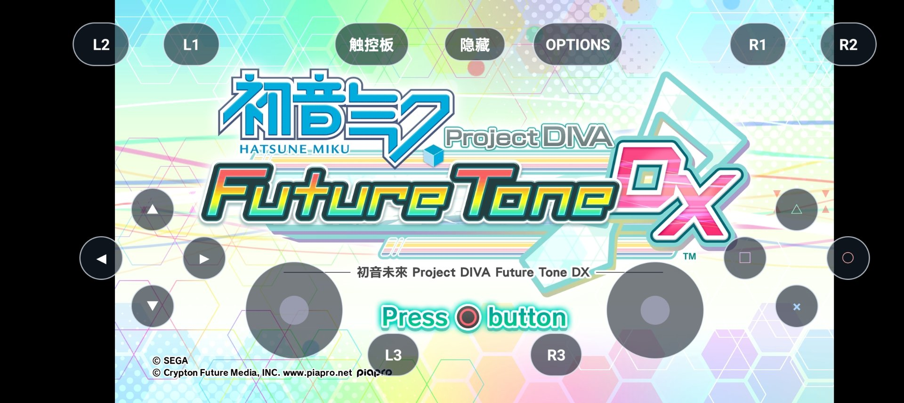
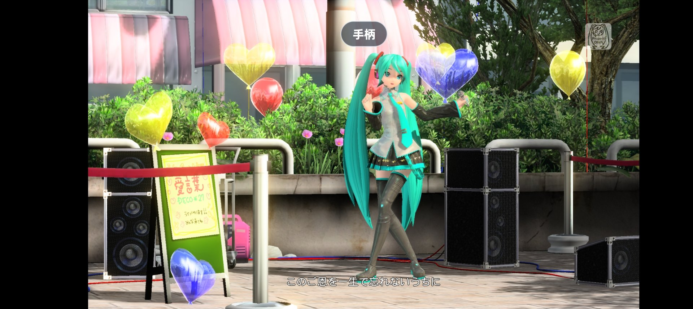
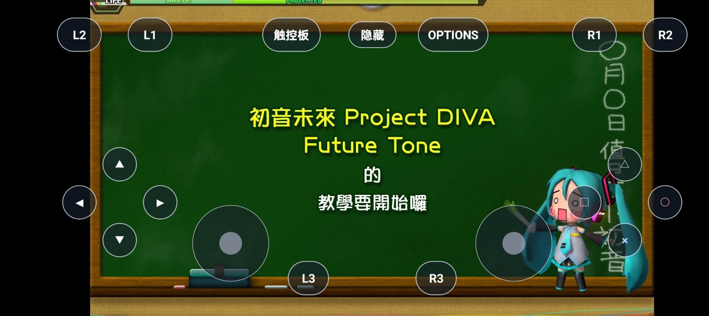

# 初音未来 Project DIVA Future Tone DX — Android 原生移植（DIVA/FTDX AOT）

<div align="center">

**把 PS4 的《初音未来 Project DIVA Future Tone DX》(CUSA08053) 原生移植到 Android**

[](https://www.android.com/)
[](https://en.wikipedia.org/wiki/AArch64)
[](LICENSE)

</div>

> **这是什么**：这是**原生移植，不是模拟器**。游戏代码经 AOT 预先编译为 ARM64 native code，GPU 命令与着色器由 shadPS4 渲染后端翻译成 Vulkan，直接在 Android 上运行。你需要自备正版游戏文件。
>
> **当前状态（如实）**：**能正常进入并游玩游戏，但帧率偏低、且没有声音**。黑屏/卡死已解决；性能与音频仍在攻坚中。详见 [`CURRENT_SITUATION.md`](CURRENT_SITUATION.md)。不谎报进展。

---

## 运行截图

游戏在本项目下的实际运行画面（含屏幕虚拟手柄）：

| 标题画面 | 3D 演出场景 |
|:---:|:---:|
|  |  |
| *Press ○ 进入游戏，虚拟按键覆盖在画面上* | *角色模块与舞台场景实时渲染* |

<p align="center">
  
  <br><sub>教学 / 剧情画面，右上角"手柄"按钮可切换虚拟手柄显示</sub>
</p>

---

## 目录

- [特性](#特性)
- [如何运行](#如何运行)
- [操作方式](#操作方式)
- [性能设置](#性能设置)
- [当前已知问题](#当前已知问题)
- [项目结构](#项目结构)
- [版本历史](#版本历史)
- [构建](#构建)
- [文档索引](#文档索引)
- [致谢](#致谢)

---

## 特性

- **原生 ARM64 执行**：游戏代码 AOT 编译成 `libbbaot.so`，运行时不做指令翻译，效率高。
- **shadPS4 Vulkan 渲染后端**：PS4 GPU 命令与 GCN 着色器在设备 Vulkan 上翻译执行；支持 Adreno（骁龙）设备。
- **屏幕虚拟手柄**：完整的 PS4 按键映射（L1/L2/L3/R1/R2/R3、双摇杆、方向键、△○×□、触控板），可显示/隐藏与调整布局。
- **性能设置面板**：分辨率预设、升采样器（FSR/GSR）、帧率上限、纹理质量、异步着色器等可调。
- **实时 FPS HUD**：可叠加显示帧率与渲染统计。
- **存档支持**：游戏存档读写已打通（含存档 GUI 与错误诊断）。
- **引擎级优化**：已移植 shadPS4 官方 `fast_shader_math`（v6.0），two-stage draw pipe 等。

---

## 如何运行

1. **安装 APK**：从 [`releases/`](releases/) 下载最新 `DIVA-Launcher-v7.0-AudioFix.apk` 并安装（签名与既有版本一致，可直接覆盖；若从其他签名版本升级需先卸载）。
2. **准备游戏文件**：把正版 DIVA/FTDX（CUSA08053）的游戏目录放到手机存储（包含 `eboot.bin`、`sce_module/`、`sce_sys/` 等）。**需要用户自备游戏**。
3. **启动并选择游戏目录**：在启动器里指定游戏文件夹。
4. **开始游戏**：首次启动会做初始化，之后按提示进入。
5. **抓取日志**：出问题时把 `diva-boot.log`、`bbpresent-diag.log`、`bbport.ini` 一起提供，便于定位。

> Mali GPU 设备未获支持；本项目主要针对骁龙 Adreno 设备。

---

## 操作方式

游戏内点击右上角 **"手柄"** 按钮可切换虚拟手柄的显示/隐藏。虚拟手柄布局：

- **左上**：L2 / L1 / 触控板 / 隐藏 / OPTIONS / R1 / R2
- **左侧**：方向键 + 左摇杆
- **右侧**：△○×□ + 右摇杆
- **底部**：L3 / R3

同时支持连接实体手柄（按键重映射可在设置里调整）。

---

## 性能设置

启动器的性能设置面板提供以下选项：

| 选项 | 说明 |
|---|---|
| 分辨率预设 | 原生 1920×1080 / 960×540 / 640×360 等内部渲染分辨率 |
| 升采样器 | FSR / GSR / 关闭 |
| 帧率上限 | 可配置 FPS 上限 |
| 纹理质量 | 全质量 / 四分之一等 |
| 异步着色器 | 异步编译开关 |
| FPS HUD | 实时显示帧率与渲染统计 |

**关于流畅度的实话**：当前复杂 3D 场景实测约 21–28 FPS，瓶颈在 CPU 侧的 draw 提交与内存管理（GPU idle 达 81–86%），不在图形算力。降低内部渲染分辨率与换用轻量升采样器是当前最直接可行的改善手段。详见 [`CURRENT_SITUATION.md`](CURRENT_SITUATION.md)。

---

## 当前已知问题

| 问题 | 状态 | 说明 |
|---|---|---|
| 黑屏 / 卡死 | ✅ 已解决 | 定位为 so byte patch 引起；v5.0（=v3.7 稳定基准）起不再出现 |
| 卡顿（21–28 FPS） | ⚠️ 未解决 | 瓶颈为 CPU draw 提交/内存管理，非 GPU 算力；fast math 帮助有限 |
| 没有声音 | ⚠️ 未解决 | guest 音频产出与 native 写 FIFO 正常；Java AudioTrack 播放段是日志盲区，v7.0 已修部分隐患但待确认 |

诚实说明：以上均未使用未验证的猜测冒充根因。每一项都有对应的日志证据或明确标注为"待确认"。

---

## 项目结构

```
.
├── src/                    # Bionic 运行时（HLE 系统库：audio/file/save/pad/... ）
├── gpu/shadps4/            # shadPS4 渲染后端（Vulkan、着色器翻译、pipeline）
├── cpu/                    # guest CPU 接口
├── launcher/               # 引擎侧 launcher 脚本
├── divaft-port/            # DIVA 移植工程层
│   ├── aot/                # AOT 流程、launcher、overlay、补丁
│   ├── runtime/            # DIVA 运行时数据
│   ├── shader_build/       # 着色器构建
│   └── docs/               # 移交文档
├── docs/images/            # 运行截图
├── releases/               # 各版本 APK、说明、性能优化研究报告
├── CURRENT_SITUATION.md    # 当前处境（本文配套，如实记录）
├── PROJECT_HANDOFF.md      # 工程接续总入口
└── README.engine.md        # fork 来源 Bloodborne-Android 的引擎原始 README
```

本仓库根目录是从 [Bloodborne-Android](https://github.com/ducvd89/Bloodborne-Android) fork 的运行时引擎，DIVA 专属部分集中在 `divaft-port/`。

---

## 版本历史

| 版本 | 关键变化 |
|---|---|
| v1.x | 存档 GUI 与错误诊断、AOT 保存修复 |
| v2.x | 诊断版本、空目录挂载修复 |
| v3.0–3.3 | 性能设置面板、场景缩放、纹理质量、帧生成 |
| **v3.7** | **稳定基准**：native 强制 flip_rate=0，解锁 30fps 锁，不卡死 |
| v3.8–4.2 | d7 性能配置实验 → 黑屏/中途卡死（已弃用） |
| **v5.0** | **回到 v3.7 逐字节稳定基准** |
| v6.0 | 移植 shadPS4 `fast_shader_math`，重编 `libbbgpu.so` |
| **v7.0** | Java `AudioBridge` 无声隐患修复 + 诊断 |

完整变更见各版本提交记录与 `releases/` 下的版本说明。

---

## 构建

DIVA launcher 的构建脚本在 `divaft_Android/tools/build_diva_launcher.sh`（本地工作副本）。引擎 so 的增量构建：

```bash
cd _build/bb-android
ninja -C out/bionic/gpu bbgpu
```

DOC：DIVA 移植的完整构建与接续流程见 [`PROJECT_HANDOFF.md`](PROJECT_HANDOFF.md) 和 [`divaft-port/aot/docs/FTDX-移交文档.md`](divaft-port/aot/docs/FTDX-移交文档.md)。

---

## 文档索引

| 文档 | 内容 |
|---|---|
| [`CURRENT_SITUATION.md`](CURRENT_SITUATION.md) | **当前处境**：真实现状、版本演化、未解问题、技术路线 |
| [`PROJECT_HANDOFF.md`](PROJECT_HANDOFF.md) | 工程接续总入口 |
| [`releases/PS4AOT性能优化研究报告.md`](releases/PS4AOT性能优化研究报告.md) | PS4 原生移植性能优化研究 |
| [`releases/README-v6.0-FastMath.md`](releases/README-v6.0-FastMath.md) | fast math 版说明 |
| [`releases/README-v7.0-AudioFix.md`](releases/README-v7.0-AudioFix.md) | 音频修复版说明 |
| [`README.engine.md`](README.engine.md) | fork 来源引擎原始 README |

---

## 致谢

本项目基于 [Bloodborne-Android](https://github.com/ducvd89/Bloodborne-Android) 的运行时引擎，使用 shadPS4 的渲染后端思想，并借鉴多个 PS4 原生移植项目的优化经验。游戏《初音未来 Project DIVA Future Tone DX》版权归 SEGA / Crypton Future Media 所有；本项目不分发游戏内容，请自备正版。

---

<div align="center">

**项目所有者**：[@Ziran123lst](https://github.com/Ziran123lst) · **仓库**：[divaft-aot](https://github.com/Ziran123lst/divaft-aot)

</div>
